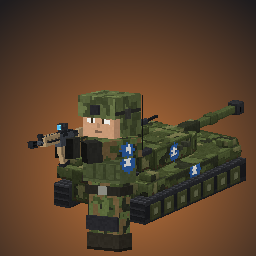
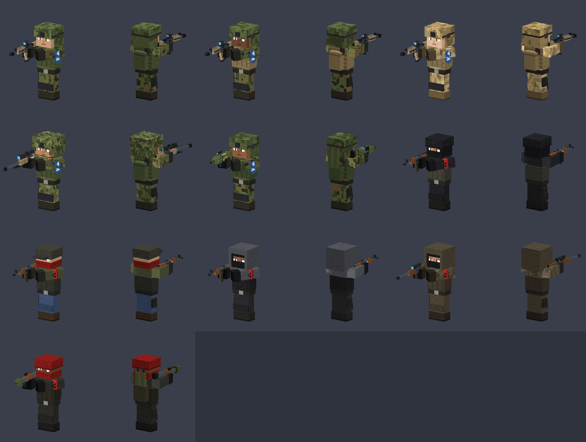
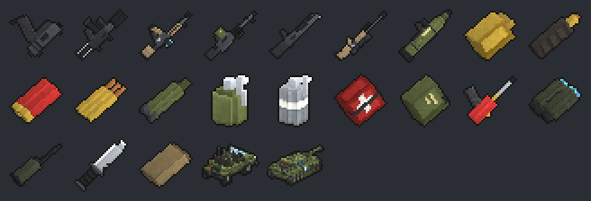

# Frontline: NATO vs Red Fang

A large-scale military battle add-on for **Minecraft Bedrock Edition**. Pick a side, **NATO** or the **Red Fang** terror cell, and fight
conquest battles over a line of capture flags with AI soldiers, four classes, detailed 3D guns, jeeps and tanks.



- **Download:** [`dist/Frontline_NATO_vs_Red_Fang.mcaddon`](dist/Frontline_NATO_vs_Red_Fang.mcaddon)
- **Requires:** Minecraft Bedrock **1.21.90 or newer**
- **No experimental toggles.** It uses only stable features and the stable `@minecraft/server` / `@minecraft/server-ui` **2.0.0** script APIs.
- **All original work.** Every model, texture, icon and sound is generated by the code in [`tools/`](tools/).

> A fictional game add-on. "Red Fang" is an invented faction, not modelled on any real group. NATO appears only as a game faction. It is not affiliated
> with or endorsed by NATO, Mojang or Microsoft.

## Install

1. Open `Frontline_NATO_vs_Red_Fang.mcaddon` with Minecraft. Tap it on Android/iOS, or double-click it on Windows. Both packs import.
2. Create or edit a world. Under **Behavior Packs**, activate **Frontline: NATO vs Red Fang [BP]**. The resource pack is attached automatically.
3. Join the world. You get a **Field Radio** and are asked to pick a side.

## Quick start

1. Use the **Field Radio**, then **Start a conquest battle**. Your headquarters is built where you stand, and the line of flags runs the way you face.
2. Pick the number of flags, tickets and AI soldiers per side, and whether there are vehicles.
3. Choose a **class** and a **spawn point**, then push for the flags.

## Conquest

- Stand at a flag (8 blocks) with more of your side than the enemy's to raise your colours. An enemy flag must be pulled down to neutral first.
- The side holding **more flags drains the other side's tickets**. Every death also costs a ticket. When a side reaches 0, the other wins.
- **AI soldiers** reinforce from their side's front-line flag. With no enemy in sight, they march on the nearest flag their side doesn't hold.
- After dying, you **redeploy** at headquarters, a held flag or a team **spawn beacon**.
- Each headquarters has a vehicle pad with **two jeeps and a tank**. Destroyed vehicles come back after a while.
- Ending a battle removes its soldiers, battle vehicles and flags (never a vehicle a player is sitting in).

## Classes

| Class | Weapons | Gear |
| --- | --- | --- |
| **Assault** | Vanguard Assault Rifle, Service Pistol | Frag grenades, Medkits |
| **Engineer** | Talon SMG, Hornet Rocket Launcher, Service Pistol | Repair Tool |
| **Support** | Bulwark LMG, Service Pistol | Ammo Boxes, Smoke grenades |
| **Recon** | Longshot Sniper Rifle, Service Pistol | Binoculars, Spawn Beacon, Smoke grenade |

Everyone also gets a combat knife, an iron helmet and chestplate if they have none, and field rations. Kits only **top up** your inventory and never take anything away.

## Weapons


Every gun, the launcher, knife, grenades and gear are **3D models in your hand**, in both first and third person. Players holding a gun are shown
**aiming it with both hands** to everyone else.

| Gun | Magazine | Notes |
| --- | --- | --- |
| Service Pistol | 12 | Quick sidearm |
| Talon SMG | 30 | 3-round bursts, suppressed |
| Vanguard Assault Rifle | 30 | 3-round bursts, red-dot sight |
| Bulwark LMG | 100 | 5-round bursts, long reload |
| Breacher Shotgun | 6 | 8 pellets, short range |
| Longshot Sniper Rifle | 5 | 22 damage, ×2.5 on headshots |
| Hornet Rocket Launcher | 1 | Explosive rocket, made for vehicles |

- **Fire:** use the gun (right-click, or hold-tap on mobile). Rifles fire short bursts.
- **Aim:** crouch to steady your aim. Sprinting spreads your shots.
- **Reload:** automatic when the magazine is empty, or **double-tap crouch**.
- **Headshots** deal extra damage. Hits show a hit marker, and kills are announced in a kill feed.
- Spare ammo is an inventory item. The status bar shows `magazine/size | reserve`.
- Teammates are never shot (friendly fire is a setting).

## Vehicles


- **Jeep:** 4 seats and fast. Passengers can shoot their guns. Red Fang jeeps are technicals with a mounted machine gun (decoration only).
- **Tank:** the turret and barrel follow where the commander looks. In the commander's seat, **use any item to fire the cannon** (4 s reload).
- Bullets barely scratch armour: use rockets, grenades or the tank cannon. Engineers repair vehicles with the **Repair Tool**.
- Outside battles, **Jeep and Tank Deployment Kits** place a vehicle painted in your side's colours.

## Soldiers



| Side | Soldiers |
| --- | --- |
| **NATO** | Rifleman (woodland and desert camo), Marksman (ghillie hood, sniper rifle), Anti-Tank Gunner (rocket launcher) |
| **Red Fang** | Fighter (three outfits), Sniper, RPG Gunner |

Soldiers fire visible tracer rounds, never hurt their own side, and attack the other side's soldiers and players. Outside battles, **patrols**
of either side roam the land and fight whoever they meet. The Field Radio reports where they are.

## Gear and blocks

- **Medkit:** heals you and teammates within 5 blocks.
- **Ammo Box:** a magazine for every gun, for you and teammates within 6 blocks.
- **Binoculars:** spot an enemy for your side. Spotted enemies are marked and take 15% more damage.
- **Spawn Beacon:** a block your side can deploy on.
- **Ammo Crate:** use it to resupply.
- **Sandbags:** cover.
- **Barbed Wire:** slows and cuts anyone crossing.
- **Smoke Grenade:** a thick cloud that hides everyone inside it.
- **Frag Grenade:** explodes after 2.5 s.



## Ranks and records

Kills (+100, +25 for a headshot), captures (+150), heals, resupplies, spots and victories (+500) earn score. Your rank shows on your name tag,
next to your side: Recruit, Private, Corporal, Sergeant, Lieutenant, Captain, Major, Colonel, General. Scores also show in the pause-menu player list.

## Settings (Field Radio, then Settings)

Friendly fire · explosions break blocks (off by default) · AI patrols and how often · AI damage (low/normal/high) · status bar on/off.

## Recipes

Every gun, ammo type, grenade and piece of gear can be crafted at a crafting table. Guns use iron, blackstone and copper. Ammo uses gunpowder
with copper or iron nuggets. Vehicle kits use iron blocks, coal blocks, TNT and obsidian. Recipes show in the crafting book.

## Development

```
python3 tools/gen/generate.py --preview   # pack JSON + 3D models, icons, sounds (+ preview images in docs/images)
python3 tools/validate.py                 # every reference between files resolves
npm install && npm run check              # type-check the scripts against @minecraft/server 2.0.0
node tools/sim/test.js                    # play the scripts in a simulated world (46 checks)
python3 tools/build.py                    # validate and package dist/*.mcaddon
```

- `tools/gen/defs.py`: the list of everything (items, blocks, soldiers, vehicles, sounds).
- `tools/gen/held.py`: the 3D guns and gear. `tools/gen/holds.py` works out how they sit in the hand. `tools/gen/viewer.py` draws them held.
- `tools/gen/models.py`: soldiers, vehicles, projectiles, the capture flag and block models (built with `modelkit.py`, adapted from the Overlord add-on).
- `behavior_pack/scripts/`: `weapons.js` (guns), `battle.js` (conquest and AI director), `vehicles.js`, `explosives.js`, `gear.js`,
  `teams.js` (sides, ranks, kill feed), `patrols.js`, `ui.js` (Field Radio), `main.js`.

### Status

The packs pass the validator, the scripts pass a strict type check against the official 2.0.0 API definitions, and the gameplay runs through
the simulated-world test. **It has not been play-tested inside Minecraft yet.** The likeliest things to need tuning are gun positions in the
hand, vehicle seat heights, jeep and tank speeds, and AI accuracy. Please report what looks or feels off.

## License

MIT, see [LICENSE](LICENSE).
