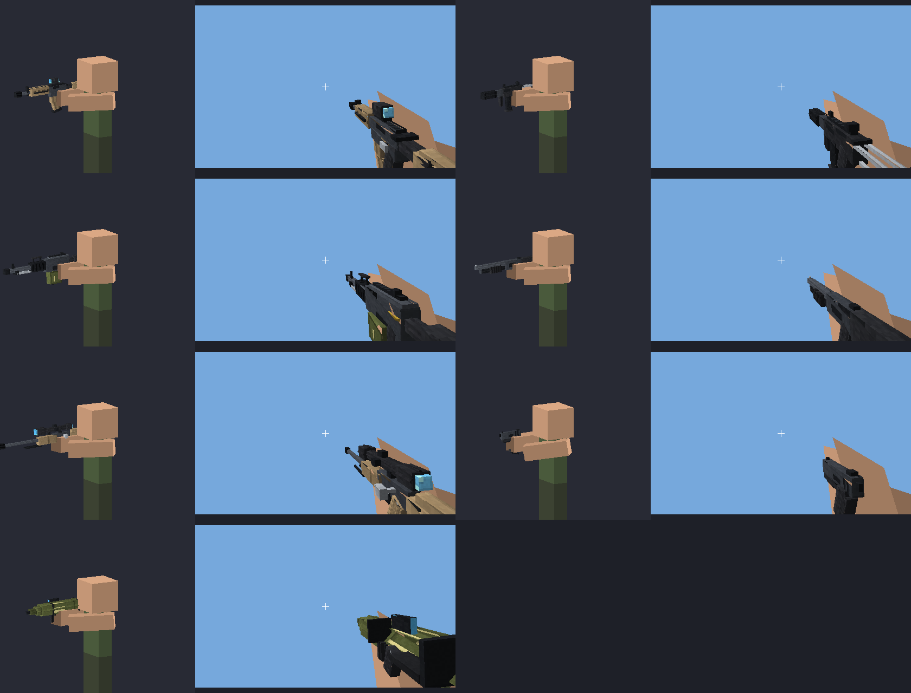
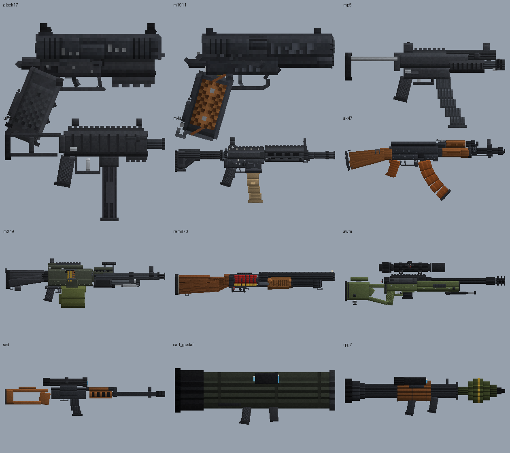
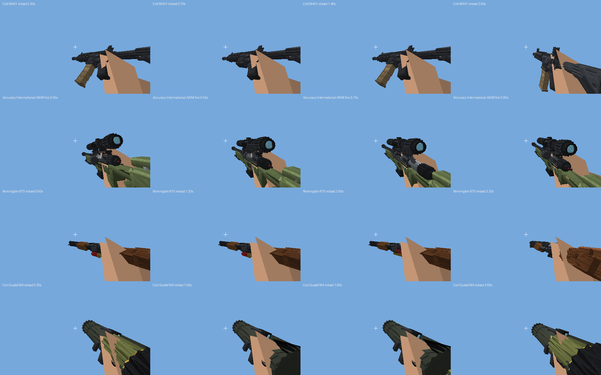
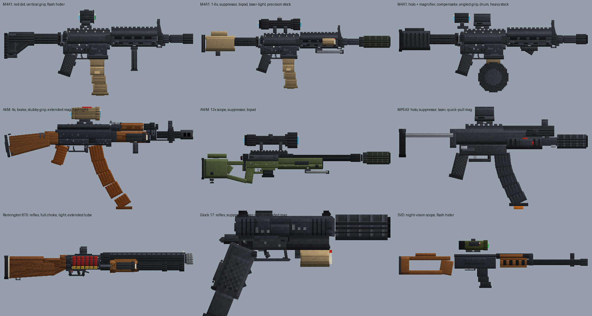
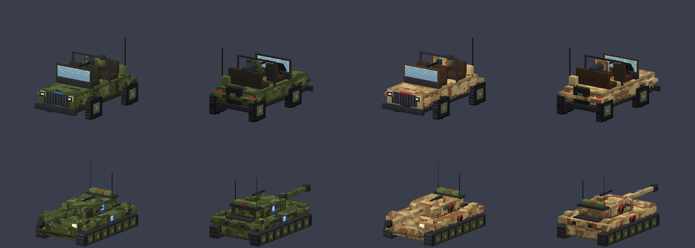

# Frontline: NATO vs Red Fang

A large-scale military battle add-on for **Minecraft Bedrock Edition**. Pick a side, **NATO** or the **Red Fang** terror cell, and fight
conquest battles over a line of capture flags with AI soldiers, four classes, jeeps and tanks. There are seventeen real-world guns, each a
detailed 3D model firing its real cartridge, with real bullet flight and drop, recoil and spread, and 33 attachments.


- **Download:** [`dist/Frontline_NATO_vs_Red_Fang.mcaddon`](dist/Frontline_NATO_vs_Red_Fang.mcaddon)
- **Requires:** Minecraft Bedrock **1.21.90 or newer**
- **No experimental toggles.** It uses only stable features and the stable `@minecraft/server` / `@minecraft/server-ui` **2.0.0** script APIs.
- **All original work.** Every model, texture, icon and sound is generated by the code in [`tools/`](tools/).

> A fictional game add-on. "Red Fang" is an invented faction, not modelled on any real group. NATO appears only as a game faction. It is not affiliated
> with or endorsed by NATO, Mojang or Microsoft.

## Install

1. Open `Frontline_NATO_vs_Red_Fang.mcaddon` with Minecraft. Tap it on Android/iOS, or double-click it on Windows. Both packs import.
2. Create or edit a world. Under **Behavior Packs**, activate **Frontline: NATO vs Red Fang [BP]**. The resource pack is attached automatically.
3. Join the world. You get a **Field Radio** and are asked to pick a side.

## Quick start

1. Use the **Field Radio**, then **Start a conquest battle**. Your headquarters is built where you stand, and the line of flags runs the way you face.
2. Pick the number of flags, tickets and AI soldiers per side, and whether there are vehicles.
3. Choose a **class** and a **spawn point**, then push for the flags.

## Conquest

- Stand at a flag (8 blocks) with more of your side than the enemy's to raise your colours. An enemy flag must be pulled down to neutral first.
- The side holding **more flags drains the other side's tickets**. Every death also costs a ticket. When a side reaches 0, the other wins.
- **AI soldiers** reinforce from their side's front-line flag. With no enemy in sight, they march on the nearest flag their side doesn't hold.
- After dying, you **redeploy** at headquarters, a held flag or a team **spawn beacon**.
- Each headquarters has a vehicle pad with **two jeeps and a tank**. Destroyed vehicles come back after a while.
- Ending a battle removes its soldiers, battle vehicles and flags (never a vehicle a player is sitting in).

## Classes

Each side carries its own guns. Kit guns come with a few attachments already fitted.

| Class | NATO | Red Fang | Gear |
| --- | --- | --- | --- |
| **Assault** | Colt M4A1 (red dot, vertical grip), Glock 17 | AKM (compensator), M1911A1 | Frag grenades, Medkits |
| **Engineer** | H&K MP5A3 (reflex sight), Carl Gustaf M4, Glock 17 | H&K UMP45, RPG-7, M1911A1 | Repair Tool |
| **Support** | FN M249 SAW (holographic sight), Glock 17 | PKM, M1911A1 | Ammo Boxes, Smoke grenades |
| **Recon** | AI AWM, Glock 17 (suppressed) | SVD Dragunov, M1911A1 | Binoculars, Spawn Beacon, Smoke grenade |

Everyone also gets a combat knife, an iron helmet and chestplate if they have none, and field rations. Kits only **top up** your inventory and never take anything away.
The Desert Eagle, P90, SCAR-H and Barrett M82A1 are crafted or taken from fallen soldiers.

## Weapons



Every gun, launcher, knife, grenade and piece of gear is a **3D model in your hand**, in both first and third person. Players holding a
gun are shown **aiming it with both hands** to everyone else.

The guns are modelled after the real ones at quarter-pixel detail, from 110 to 370 parts each:
- machined and stamped receivers with pins, screws, rivets and roll marks
- ejection ports, bolt carriers, charging handles, safeties and magazine releases
- round, fluted barrels; birdcages, slant brakes and muzzle brakes
- picatinny rails with real teeth, M-LOK handguards with real slots, wooden and polymer furniture
- curved and box magazines with ribs, feed lips and the top round showing
- sights, scopes with glass, bipods



Their moving parts are animated:
- **Firing:** recoil, with the bolt, slide, hammer or charging handle cycling. The shotgun pumps and the AWM works its bolt.
- **Reloading:** the gun rolls towards you, the magazine drops out, a fresh one goes in, and the charging handle, slide or bolt is racked.
  The shotgun loads shell by shell, the M249 opens its top cover and swaps the ammo pouch, the RPG-7 takes a new rocket in front,
  and the Carl Gustaf swings its venturi open and takes a round from behind.
- **Jams and malfunctions:** clearing them plays its own animation (see below).



| Gun | Cartridge | Magazine | Fire | Muzzle velocity |
| --- | --- | --- | --- | --- |
| Glock 17 | 9x19mm Parabellum | 17 | semi | 375 m/s |
| Colt M1911A1 | .45 ACP | 7 | semi | 253 m/s |
| H&K MP5A3 | 9x19mm Parabellum | 30 | auto, 800 rpm | 400 m/s |
| H&K UMP45 | .45 ACP | 25 | auto, 600 rpm | 285 m/s |
| Colt M4A1 | 5.56x45mm NATO | 30 | auto, 800 rpm | 910 m/s |
| AKM (AK-47) | 7.62x39mm | 30 | auto, 600 rpm | 715 m/s |
| FN M249 SAW | 5.56x45mm NATO | 200 | auto, 800 rpm | 915 m/s |
| Remington 870 | 12 Gauge 00 Buckshot | 4 | pump, 9 pellets | 400 m/s |
| Accuracy International AWM | .338 Lapua Magnum | 5 | bolt | 914 m/s |
| SVD Dragunov | 7.62x54mmR | 10 | semi | 830 m/s |
| Carl Gustaf M4 | 84mm HEAT Round | 1 | recoilless rifle | rocket |
| RPG-7 | PG-7V Rocket | 1 | rocket launcher | rocket |
| IWI Desert Eagle | .50 Action Express | 7 | semi | 470 m/s |
| FN P90 | 5.7x28mm | 50 | auto, 900 rpm | 715 m/s |
| FN SCAR-H | 7.62x51mm NATO | 20 | auto, 600 rpm | 790 m/s |
| Barrett M82A1 | .50 BMG | 10 | semi | 853 m/s |
| PKM | 7.62x54mmR | 100 | auto, 650 rpm | 825 m/s |

Each cartridge is its own ammunition item: 9x19mm, .45 ACP, .50 AE, 5.7x28mm, 5.56x45mm, 7.62x39mm, 7.62x51mm, 7.62x54mmR,
.338 Lapua Magnum, .50 BMG, 12 gauge, 84mm and PG-7V.

### Shooting

- **Fire:** use the gun (right-click, or hold-tap on mobile). Hold it for automatic fire. Pistols, the SVD, the shotgun and the AWM fire
  once per press; the pump and bolt guns must cycle between shots.
- **Aim:** crouch to aim. Aimed fire is far tighter and kicks less, and magnified optics zoom.
- **Reload:** automatic when the magazine is empty, or **double-tap crouch**.
- **Jams:** now and then a gun stops. Clear it by double-tapping crouch.
  - **JAMMED:** tap and rack the gun; one round is lost.
  - **MALFUNCTION** (rarer): strip the magazine, rack it and reload; two rounds are lost.
  - The M249 and shotgun stop most often, the AWM least. You can turn jams off in Settings.
- **Headshots** deal extra damage. Hits show a hit marker, and kills are announced in a kill feed.
- The status bar shows the gun, its cartridge, its fire mode and `magazine/size | reserve`.
- Teammates are never shot (friendly fire is a setting).

### Ballistics

Every round is a **real bullet in flight**, simulated every game tick at 1 block = 1 metre:
- It leaves the muzzle at its cartridge's **real velocity** (table above), loses speed to **air drag** and **falls with gravity**
  (9.81 m/s²).
- Close up it lands at once. Far away it takes its real time of flight and **drops on the way**, so you lead moving targets and hold over
  at long range. Slow pistol and SMG rounds drop the most; the .338 Lapua flies flattest.
- Sights are zeroed at 25 blocks (pistols) and 100 blocks (rifles): the bullet rises to the line of sight there, then falls below it.
- A bullet does less damage as it slows down. Shotgun pellets fly and fall one by one.
- Tracers show each bullet's arc, and supersonic rounds **crack** past anyone they narrowly miss.
- Settings: bullet drop off, realistic or heavy (x3); tracers on or off.

### Recoil and spread

All guns share one recoil and spread system, tuned per gun:
- **Recoil** kicks your view up and to a random side with every shot. After a burst it settles part of the way back. It can be turned
  off in Settings ("Recoil moves the view").
- **Spread** is each gun's hip-fire cone, or its much tighter aimed cone when you crouch. It widens while you walk, a lot while you sprint,
  and even more while you jump or fall.
- **Bloom:** sustained fire widens the spread with every shot, and it recovers once you stop. Short bursts are more accurate.
- Attachments change all of these (below).

## Attachments



**33 attachments**, each a 3D model of its own, modelled onto every gun it fits. Fit them at the **Gunsmith** (Field Radio, then
Gunsmith), or use an attachment item and pick a gun. Fitting takes the attachment from your inventory, and removing it gives it back.
Craft them at a crafting table, or take them from fallen soldiers.

| Slot | Attachments |
| --- | --- |
| **Optic** | Mini Reflex, Red Dot, Holographic, Holographic + 3x Magnifier, 2x Prism, 4x Combat, 1-6x Variable, 8x Marksman, 12x Sniper, 4x Night Vision |
| **Muzzle** | Pistol Suppressor, Rifle Suppressor, Compensator, Muzzle Brake, Flash Hider, Full Choke, Cylinder Choke |
| **Underbarrel** | Vertical Grip, Angled Grip, Stubby Grip, Handstop, Bipod |
| **Side rail** | Laser Sight, Tactical Flashlight, Laser-Light Module |
| **Stock** | Heavy, Lightweight, Precision |
| **Magazine** | Extended, Drum, Quick-Pull, Extended Shotgun Tube, 300-Round Box |

What they do:
- **Optics** tighten aimed spread. Magnified ones **zoom while you crouch** (turn on "FOV changes" in Video settings). The night-vision
  scope gives night vision while you aim through it.
- **Suppressors** make the shot quiet and hide the muzzle flash. **Compensators** cut horizontal recoil, **muzzle brakes** cut vertical
  recoil, and **chokes** tighten the shotgun's pattern.
- **Grips:** the vertical grip cuts vertical recoil and the angled grip horizontal recoil. The **bipod** braces the gun while you crouch.
- **Lasers** tighten hip fire and put a red dot (with a beam) where the gun points. **Flashlights** light up whatever you aim at.
- **Stocks** trade recoil for handling. **Magazines** hold more rounds or reload faster.

Every attachment's exact effects and the guns it fits are listed in [docs/attachments.md](docs/attachments.md).

Fitted attachments are drawn on the gun in **your own** hands, in first and third person. They are shown through cooldowns of the item in
hand, which only the holder's game knows, so other players see the gun in its factory form.

## Money and the Armory

- Everyone starts with **$1,000**.
- **Funding** arrives every 2 minutes (a setting, 1 to 10): **$300** from the government for NATO, or from the cell's backers for
  the Red Fang.
- **Bounties:**
  - $150 for each enemy soldier, plus $75 for a headshot
  - $300 for an enemy player
  - $500 for a vehicle
  - $250 for capturing a flag
  - $1,000 for winning a battle
- The **Armory** (Field Radio, then Armory) sells everything:
  - **Weapons:** all 17 guns, from $300 for a Glock to $4,500 for a Barrett
  - **Ammunition:** packs of every cartridge
  - **Attachments:** all 33, by slot
  - **Equipment:** grenades, medkits, ammo boxes, a repair tool, sandbags, barbed wire, spawn beacons
  - **Vehicles:** a jeep for $1,500 and a tank for $5,000 (deployment kits)
- Your balance shows in the Field Radio and on the status bar next to your ammo. Creative players buy for free.

## Vehicles



- **Jeep:** 4 seats and fast. Passengers can shoot their guns. Red Fang jeeps are technicals with a mounted machine gun (decoration only).
- **Tank:** the turret and barrel follow where the commander looks. In the commander's seat, **use any item to fire the cannon** (4 s reload).
- Bullets barely scratch armour: use rockets, grenades or the tank cannon. Engineers repair vehicles with the **Repair Tool**.
- Outside battles, **Jeep and Tank Deployment Kits** place a vehicle painted in your side's colours.

## Soldiers


| Side | Soldiers |
| --- | --- |
| **NATO** | Rifleman (woodland and desert camo), Marksman (ghillie hood, sniper rifle), Anti-Tank Gunner (rocket launcher) |
| **Red Fang** | Fighter (three outfits), Sniper, RPG Gunner |

Soldiers fire visible tracer rounds, never hurt their own side, and attack the other side's soldiers and players.

- **Death animation:** a soldier who dies crumples and falls, backwards onto its back or forwards onto its face. The body lies there
  for a few seconds, then sinks into the ground.
- **Loot:** a soldier you kill drops its gear:
  - the gun it carried, sometimes with attachments fitted
  - ammunition for that gun
  - sometimes a spare attachment, a medkit or a ration

  Pick them up and use them. Outside battles, **patrols**
of either side roam the land and fight whoever they meet. The Field Radio reports where they are.

## Gear and blocks

- **Medkit:** heals you and teammates within 5 blocks.
- **Ammo Box:** a magazine for every gun, for you and teammates within 6 blocks.
- **Binoculars:** spot an enemy for your side. Spotted enemies are marked and take 15% more damage.
- **Spawn Beacon:** a block your side can deploy on.
- **Ammo Crate:** use it to resupply.
- **Sandbags:** cover.
- **Barbed Wire:** slows and cuts anyone crossing.
- **Smoke Grenade:** a thick cloud that hides everyone inside it.
- **Frag Grenade:** explodes after 2.5 s.


## Ranks and records

Kills (+100, +25 for a headshot), captures (+150), heals, resupplies, spots and victories (+500) earn score. Your rank shows on your name tag,
next to your side: Recruit, Private, Corporal, Sergeant, Lieutenant, Captain, Major, Colonel, General. Scores also show in the pause-menu player list.

## Settings (Field Radio, then Settings)

Friendly fire · explosions break blocks (off by default) · AI patrols and how often · AI damage (low/normal/high) · status bar on/off ·
weapon jams and malfunctions · recoil moves the view · bullet drop (off/realistic/heavy) · tracers · minutes between funding payments ·
vanilla mobs.

**Vanilla mobs are off by default.** Animals, monsters and villagers are removed as they spawn, and when loaded, so only the soldiers fight
over the land. Pets you have tamed, mobs with a name tag, armor stands and the ender dragon are kept. Turn "Vanilla mobs" on in Settings
to bring the others back.

## Recipes

Every gun, cartridge, attachment, grenade and piece of gear can be crafted at a crafting table. Guns use iron, blackstone, copper and wood.
Ammunition uses gunpowder with copper and iron. Optics use glass and spyglasses; suppressors use wool. Vehicle kits use iron blocks,
coal blocks, TNT and obsidian. Recipes show in the crafting book.

## Development

```
python3 tools/gen/generate.py --preview   # pack JSON + 3D models, icons, sounds (+ preview images in docs/images)
python3 tools/validate.py                 # every reference between files resolves
npm install && npm run check              # type-check the scripts against @minecraft/server 2.0.0
node tools/sim/test.js                    # play the scripts in a simulated world (98 checks)
python3 tools/build.py                    # validate and package dist/*.mcaddon
```

- `tools/gen/defs.py`: the list of everything (items, blocks, soldiers, vehicles, sounds).
- `tools/gen/guns_a.py`, `guns_b.py`, `guns_c.py`: the twelve 3D guns (with `kit.py`, the modelling kit, and `gunbase.py`).
- `tools/gen/attach.py`: the attachment catalogue (names, slots, the guns each fits, effects) and the attachment models.
- `tools/gen/held.py`: gathers every held item: the guns with their attachments, the knife, the grenades and the gear.
- `tools/gen/gunanims.py`: the guns' fire, reload, jam and malfunction animations.
- `tools/gen/holds.py`: works out how each item sits in the hand.
- `tools/gen/viewer.py`: draws items held, in first and third person, at any moment of an animation.
- `tools/gen/gunsheet.py`: side views of every weapon.
- `tools/gen/models.py`: soldiers, vehicles, projectiles, the capture flag and block models (built with `modelkit.py`, adapted from the Overlord add-on).
- `behavior_pack/scripts/`:
  - `weapons.js`: triggers, recoil and spread, magazines, jams, scopes, lasers and flashlights
  - `ballistics.js`: bullets in flight
  - `attachments.js`, `gunsmith.js`: attachments and the Gunsmith
  - `economy.js`, `shop.js`: money, funding and the Armory
  - `soldiers.js`: death animations (bodies), the gear soldiers drop, keeping vanilla mobs away
  - `battle.js` (conquest and AI director), `vehicles.js`, `explosives.js`, `gear.js`, `teams.js` (sides, ranks, kill feed),
    `patrols.js`, `ui.js` (Field Radio), `main.js`
  - `gundata.js` (generated): gun stats, animation timings, mounts and the attachment catalogue

### Status

The packs pass the validator, the scripts pass a strict type check against the official 2.0.0 API definitions, and the gameplay runs through
the simulated-world test. **It has not been play-tested inside Minecraft yet.** The likeliest things to need tuning are:
- gun positions in the hand, and attachment positions on the guns
- recoil strength and bullet drop
- vehicle seat heights
- jeep and tank speeds
- AI accuracy

The guns' own animations and the attachments on the model rely on Minecraft letting the held model read cooldowns
(`q.cooldown_time`, `q.cooldown_time_remaining`). If they don't show in your version, firing, reloading, jams and every attachment's
effect still work; only the 3D parts stay still or bare. Recoil turns the view with `setRotation`; if your version ignores that for
players, spread and bloom still apply. Please report what looks or feels off.

## License

MIT, see [LICENSE](LICENSE).
